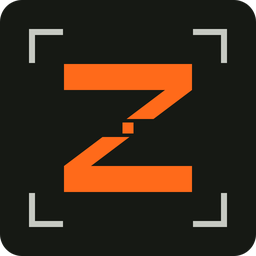
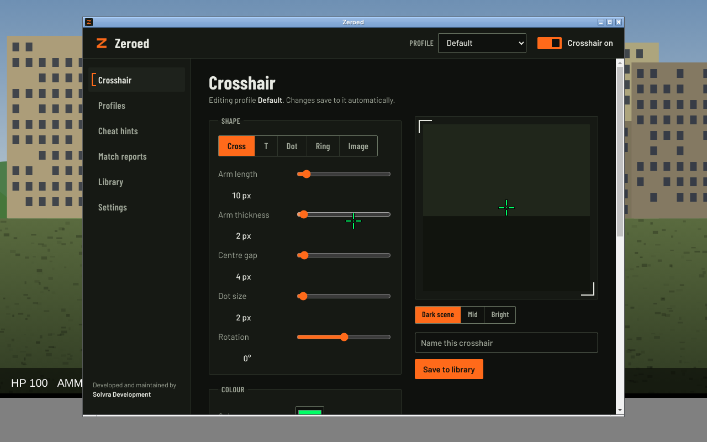
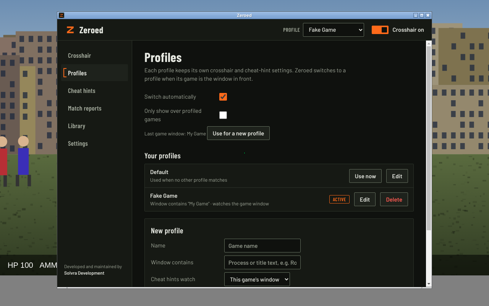
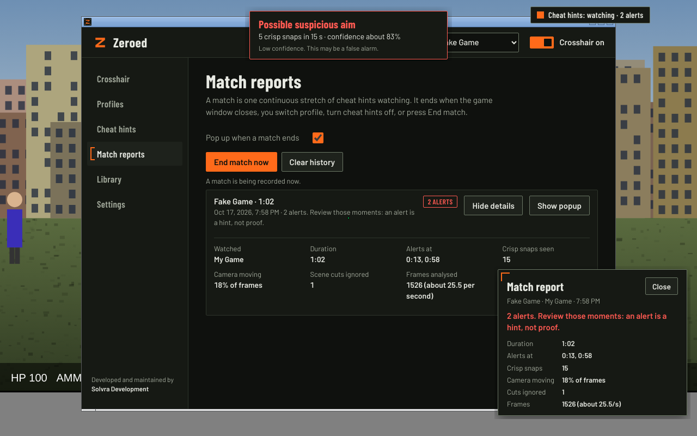

<p align="center">
  
</p>

<h1 align="center">Zeroed</h1>

<p align="center">
  A free crosshair overlay for any game, with per-game profiles and experimental cheat hints.<br>
  Developed and maintained by <strong>Solvra Development</strong>.
</p>

<p align="center">
  <a href="https://github.com/MinVT-dev/Zeroed/releases/latest"><strong>Download the latest release</strong></a>
</p>



## Download

Grab the files from the [latest release](https://github.com/MinVT-dev/Zeroed/releases/latest):

| File | What it is |
|---|---|
| `Zeroed-<version>-portable.exe` | Windows, no install. Double-click to run. |
| `Zeroed-Setup-<version>.exe` | Windows one-click installer with a Start menu entry. |
| `Zeroed-<version>.dmg` | macOS. |
| `Zeroed-<version>.AppImage` | Linux. |

The Windows builds are not code-signed yet, so SmartScreen may warn the first time. Choose **More info → Run anyway**.

Zeroed sits in the system tray. Closing the settings window keeps it running; quit from the tray icon.

## What it does

### Crosshair
A click-through, always-on-top crosshair: your clicks still reach the game.

- Cross, T, dot, ring, or your own image (PNG, JPG, GIF or WebP, up to 1 MB)
- Arm length, thickness, centre gap, dot, outline, colour, opacity, rotation and offset
- Live preview over a dark, mid or bright scene, so you can check it stays visible
- Pick which monitor it shows on

### Per-game profiles


Each profile keeps its own crosshair and cheat-hint settings. Tell a profile which game it belongs to (any text from
the game's process name or window title) and Zeroed switches to it when that game comes to the front. You can also
hide the crosshair whenever anything other than a profiled game is in front.

Roblox runs every experience in a single window called "Roblox", so one Roblox profile covers all Roblox games.

### Cheat hints (experimental, off by default)
Zeroed can watch the screen, or one game window, while you play or spectate, and alert you when it sees several
unnaturally crisp camera snaps in a row: very fast, perfectly straight, then dead still. Human aim overshoots and
corrects; some aim assists do not.

Be clear about what this is:

- It reads pixels only. It never touches the game's memory or files, which most anti-cheats prohibit.
- It is a hint, not proof. Skilled players and fast-flick styles can trigger it, and it cannot tell you *who*.
  Never use an alert to accuse someone.
- Scene cuts (switching spectate target, round-end screens) are ignored.
- Frames are analysed in memory and thrown away. Nothing is recorded or sent anywhere.

You get a small status badge while it watches, a toast (with an optional chime) when it alerts, Low / Medium / High
presets, and advanced tuning for snap speed, snap size, hold-still time, snaps needed, crispness, counting window,
cooldown and analysis frame rate.

### Match reports


A match is one continuous stretch of cheat hints watching. When it ends (the game window closes, you switch profile,
turn cheat hints off, or press <kbd>F7</kbd>), a small popup summarises it: duration, when alerts fired, crisp snaps
seen, how much the camera moved, scene cuts ignored and frames analysed. Every number is measured, nothing is
estimated. Past matches are listed on the Match reports page. Matches under a minute are skipped.

### Library and sharing
Save crosshairs to a library, cycle through them with hotkeys, and share them as a short `ZR1:` code or as a `.zeroed`
file (a single crosshair or a whole pack, custom images included).

## Hotkeys

| Default | Action |
|---|---|
| <kbd>F10</kbd> | Crosshair on / off |
| <kbd>F9</kbd> / <kbd>F8</kbd> | Next / previous saved crosshair |
| <kbd>F7</kbd> | End the current match and show its report |

Change them under **Settings → Hotkeys**.

## Good to know

- Run games in **borderless** or **windowed** mode. Exclusive fullscreen hides every overlay, not just this one.
- Some competitive games restrict overlays. Check the rules of the game you play.
- On macOS, allow Screen Recording for cheat hints. On Linux, automatic profile switching needs `xdotool`.

## Privacy

Zeroed has no account, no analytics and no telemetry. Settings stay in your user folder. The only network feature is
the optional community gallery, which talks to a server address you enter yourself.

## Build from source

Requires Node.js 22.

```bash
git clone https://github.com/MinVT-dev/Zeroed.git
cd Zeroed
npm install
npm start           # run the app
npm test            # run the test suites
npm run dist:win    # Windows portable exe and installer (run on Windows)
npm run dist        # packages for the current OS
```

Pushing a `v*` tag builds Windows, macOS and Linux packages in GitHub Actions and attaches them to a release.

Other tools in the repo:

- `npm run analyze -- recording.mkv` replays a gameplay recording through the cheat-hint detector (needs ffmpeg) and
  lists every crisp snap and alert with its timestamp.
- `npm run gallery` starts a small self-hosted gallery server for sharing crosshairs.
- **Settings → Developer tools** unlocks a debug overlay that draws what cheat hints sees. Set your own key with
  `npm run set-dev-key -- "your key"` before you build.

## Project layout

```
src/main.js          app, windows, tray, hotkeys, settings
src/crosshair.js     crosshair drawing, share codes, files
src/detector.js      snap detector        src/motion.js     camera-motion estimate
src/profiles.js      per-game profiles    src/foreground.js front-window watcher
src/report.js        match reports
src/ui/              settings window      src/*/            overlay, alert, badge, report popup, analyzer
test/                test suites          scripts/          recording analyser, dev key tool
```

## License and credits

Zeroed is free software under the [GNU General Public License v3.0](LICENSE) or later.
Made by **Solvra Development**. Zeroed is an independent project and uses no code or assets from other crosshair apps.
Interface type is [Barlow](https://github.com/jpt/barlow) by Jeremy Tribby, under the SIL Open Font License
(`src/assets/fonts/OFL-Barlow.txt`).
